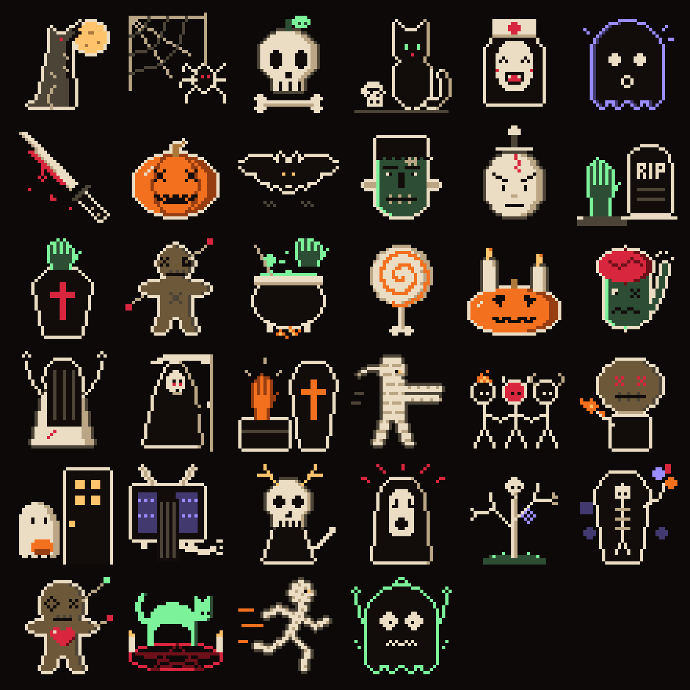

# kiro-horror-tui

LLM chat in a haunted crypt, built for **Ghostty**: a bestiary of
33 pixel-art creatures (real images via the Kitty graphics
protocol), Kiro the motionless ghost mascot (scared via F5),
apparitions that react to the chat, horror effects (candlelit
vignette, fog, static, blood drops, lightning), a header **context
gauge** (`ctx`, % of the model's context window), and a **global**
token counter (status bar: current chat + session total, all
chats and sub-agents included; F2: grimoire + souls per chat with
a TOTAL line). Terminal **≥ 80x24** required.



## Run

In Ghostty, dressed up (theme + shader, builds release if needed):

```sh
KH_API_KEY=... KH_MODEL=... ghostty/crypte
ghostty/crypte --muse-auth
ghostty/crypte --no-shader --muse-auth
```

In the current terminal:

```sh
cargo build
KH_API_KEY=... KH_MODEL=... ./target/debug/kiro-horror-tui
```

Single non-interactive call (prints the reply + a token line):

```sh
KH_API_KEY=... KH_MODEL=... ./target/debug/kiro-horror-tui --once "<text>"
./target/debug/kiro-horror-tui --muse-auth --once "<text>"
```

Check with no network or key (headless 80x24 render), previews:

```sh
./target/debug/kiro-horror-tui --smoke
./target/debug/kiro-horror-tui --help
./target/debug/kiro-horror-tui --sheet docs/bestiaire.png   # bestiary PNG
./target/debug/kiro-horror-tui --preview /tmp/crypte.ans    # 3 screens as ANSI
cat /tmp/crypte.ans                                         # read it in Ghostty
```

With no key or config, the TUI still starts, disconnected
(see `/connect` below).

## Muse Code

Prerequisite: logged-in `muse` CLI. One-command setup:

```sh
./target/debug/kiro-horror-tui --muse-auth
```

`--muse-auth` reads the key from `~/.config/muse/auth.json` (field
`providers.meta.api_key`), default base `https://api.meta.ai/v1`, default
model `muse-spark-1.3-contributor`. `KH_BASE_URL` / `KH_API_KEY` /
`KH_MODEL` take priority and override these defaults. Works with the
TUI and with `--once`. The key is never displayed nor copied.

## Config

Environment variables (prioritary):

| var | role | default |
| --- | ---- | ------ |
| `KH_BASE_URL` | OpenAI-compatible base | `https://api.openai.com/v1` |
| `KH_API_KEY` | API key (never logged; `--once` requires it) | — |
| `KH_MODEL` | model (`--once` requires it) | — |
| `KH_CONTEXT_WINDOW` | context-window override (tokens) | per-model table |
| `BRAVE_API_KEY` | premium `/web` backend (optional) | — |
| `TAVILY_API_KEY` | premium `/web` backend, LLM-tuned (optional) | — |

With `--muse-auth`, defaults become base `https://api.meta.ai/v1`
+ model `muse-spark-1.3-contributor` (key read from `auth.json`).

Or a TOML file via `--config <file>` (flat keys or `[provider]`
section, overridden by the environment):

```toml
base_url = "https://api.meta.ai/v1"
api_key = "..."
model = "muse-spark-1.3-contributor"
```

## /connect (connect from the TUI)

No key needed at launch: with no `KH_API_KEY`, `--config`
or `--muse-auth`, the TUI starts disconnected and sends
answer `not connected: /connect openai|muse`.

- `/connect` — status (provider + model, or not connected + usage).
- `/connect openai` — asks for the API key (input masked with `•`),
  then the model (empty Enter = `gpt-4o`).
- `/connect muse` — reads the `~/.config/muse/auth.json` store if
  possible, else switches to manual input (`Muse store
  unreadable, manual input`, default model
  `muse-spark-1.3-contributor`).
- `Esc` cancels the flow (`connection cancelled`), the draft is kept.
- The key is never displayed, logged or pushed into the chat:
  only the `connected to {provider} ({model})` confirmation shows.

## Context gauge

The header `ctx` gauge shows the estimated context of the current
chat (send window + draft input) as a % of the effective limit:
the model's context window (known sizes in `tokens.rs`, `128k`
fallback), capped at 1M estimated tokens. It turns from
candle to blood past 40%, then 80%. `/usage` prints the exact
fill figures, `/model` shows the window of the current
model, and `KH_CONTEXT_WINDOW` overrides it for unknown models.
Sends (chat or agent) past the limit are refused (`/compact`,
exempt, stays the remedy).

## Keys

| key | effect |
| --- | ---- |
| Enter | send the message |
| Esc / `q` (empty input) | quit |
| F2 | toggle chat / grimoire (tokens + souls per chat) |
| F3 / F4 | previous / next chat |
| Ctrl+N | new chat |
| Click `[+]` (sidebar) | new chat (mouse captured by the app) |
| F5 | scare: Kiro scared 2s, jump scare, lightning flash |
| F6 | toggle chat / bestiary (arrows to pick) |
| F7 | toggle chat / spirit hub (arrows to select, Enter opens the chat) |

## Ghostty

What the crypt uses from Ghostty (and degrades cleanly elsewhere):

- **Kitty graphics protocol** (Unicode placeholders): pixel art is
  a real image, detected at startup (`◆ kitty` in the status bar).
  Elsewhere: truecolor halfblocks (`◆ halfblocks`).
- **Truecolor** everywhere: candlelit vignette, fog, gradients, flash.
- **Built-in sprites**: rounded powerline separators, blocks, braille
  drawn pixel-perfect; embedded Nerd Font icons.
- **OSC 11** (window background, padding included), **OSC 2** (title,
  stack restored on exit), **OSC 9;4** (native progress bar while a
  reply simmers, Ghostty only), **mode 2026** (synced rendering,
  tear-free animations).
- `ghostty/crypte.conf` (palette, extended padding, 120x36) +
  `ghostty/crypte.glsl` (vignette, flame, grain — no blur: every
  pixel is read at its own place).

No sound: no bell, no notification.

## Spirit hub (F7)

Every agent lives in a crypt drawn in **isometric** pixel art:

- **white ghost** = an agent (a chat); it wanders, meets the others and
  chats (bubbles "…", heart); while waiting for the LLM it hovers in place;
- **small black ghost** = a sub-agent (`/agent`); at work it orbits its
  agent on an ectoplasm thread; done, it sleeps at its feet ("z");
  failed, it sinks with red eyes;
- **orbs**: every real message flies from sender to receiver — `/tell`,
  `/msg`, `/ask`, auto links, a sub-agent's delivery; the receiver jumps ("!");
- F5: everybody flees.

Right panel: each agent, its sub-agents and their state. Arrows select
(pumpkin ring on the floor), Enter opens that chat.

In Ghostty the scene is a Kitty image re-sent every frame under the same
id (PNG, ×2–×6 nearest neighbour, crisp); elsewhere, half-blocks.
Offline demo, no key needed:

```sh
./target/debug/kiro-horror-tui --demo
```

## Bestiary (pixel art)

33 creatures after the Dribbble shot "Halloween icons and
illustrations" (Getillustrations), **redrawn** as 32×32 pixel art
(no original image in the repo), + scared Kiro. One text grid per
creature in `assets/pixel/<slug>.txt`: 32 lines of 32 letters,
`.` = transparent, else a color from `src/theme.rs`:

| letter | color | letter | color |
| --- | --- | --- | --- |
| `W` | bone | `S` | sand |
| `U` | umber | `K` | ink |
| `O` / `o` | pumpkin / dark | `R` / `r` | blood / dried |
| `G` / `g` | ectoplasm / dark | `P` / `p` | spectre / dark |
| `Y` / `y` | candle / dark | `N` | burlap |

Crisp rendering guaranteed: **integer** nearest-neighbour upscale on
a canvas of the exact pixel size of the area (1 image pixel = 1
screen pixel in Kitty, = 1 half-cell in halfblocks). The right panel
shows Kiro and an apparition: cauldron during a reply, spider during
sub-agents, grave hand on error, coffin after `/compact`, slow
rotation otherwise.

## Model

Each chat has its model (`None` = provider default).
`/model` shows the effective model, `/model <name>` changes it
for the current chat, `/model reset` (or `default`) goes back
to the default. The status bar shows the short name (after
the last `/`, 14 chars max).

## Thinking

Global reasoning level (sent as `reasoning_effort`
**only** if `/thinking <level>` was used, otherwise
the field is omitted from the JSON). `/thinking` shows the level,
`/thinking default` goes back to default (omitted). Levels:
`default` / `low` / `medium` / `high`.

## Permissions

Mode for future tools (today the crypt modifies no files yet — the mode
is remembered for later). `/permissions` shows the mode, `/permissions yolo`
runs everything without asking, `/permissions auto` (default) asks
confirmation before every change. The choice is persisted in
`~/.config/kiro-horror-tui/permissions` and reloaded at startup.

## Sub-agents

`/agent [@<n>] <text>` starts a side request (no history but
agents.md prefixed if loaded, current model and thinking); the
reply arrives async prefixed `[agent#id]` (or `[agent#id from Chat k]`
if delivered elsewhere via `@<n>`) and the status shows in the sidebar
(`A{n}`) then via `/agents` (`running` / `done` / `failed`, tokens
used, queue in brackets). `/ask #<id> <text>` continues the
conversation with an agent (exchange kept, 20 messages max, `system`
head kept); if it is running, queued and triggered once free.
`/agents all` lists the agents of every chat.

## Dialogues between chats (bus)

`/tell <n> <text>` injects the text into chat n (prefixed `[from Chat k]`,
shown at once) and triggers its reply (target chat model, global thinking);
if it is busy, queued (grouped reply once free) — never refused, zero
retry. Only refused if the target is missing or is the current chat.
`/msg <n|@n|#id|all> <text>` talks to a chat, an agent (delivered here)
or every other chat in a parallel fan-out. `/link <a> <b>` automatically
forwards every reply from `a` to `b` (chat or agent, `[auto …]`, triggers
its reply); `/links` lists the rules + counters, `/unlink` removes. Auto
chains are capped at 8 hops (loop guard, note at the source). Every chain
stays user-originated (command or user-made link): no infinite loops.
Agent replies delivered to a chat are also versed into its context
(user role, tagged, no reply triggered — queued behind a busy chat).

## Compact

`/compact` (6 messages minimum) asks for an EN summary (< 20
lines, agents.md **excluded** from the meta summary) and replaces history
with `[pinned agents.md]` + `summary + last 4 messages`; messages
arrived during the summary are preserved. On failure, history
stays intact. Sends (chat or agent) refused past the context limit
on the send window (fill in `/usage`); exempt `/compact` stays
the remedy.

## Web search (`/web`)

`/web <query>` searches the web and delivers an LLM synthesis with
cited sources (`[n]` + `Sources:` footer), tagged `[web:backend]`.
Backend chain, first non-empty wins: Tavily (`TAVILY_API_KEY`) →
Brave (`BRAVE_API_KEY`) → DuckDuckGo (free) → Wikipedia FR+EN
(free, always available). No key required: free backends work out
of the box, premium keys just rank first. Optimized: 8 s per backend,
20 s deadline, fetch skipped when snippets suffice, query-relevant
passages, fair per-source budgets, 10 min cache. Works disconnected
too (raw results, zero tokens); the provider history is untouched
(display + ledger only, like agents).

## AGENTS.md (system context)

At startup, the binary loads `./AGENTS.md` then `./AGENT.md` from
the cwd (`--agents-file <file>` wins over both), once
(restart to reload). Injected as a `system` message atop the
history of every chat (new ones included, `/new` and Ctrl+N) and
prefixed to `/agent` calls. Excluded from `/compact` (meta summary)
and from `--once` (raw). Startup announcement (`AGENTS.md loaded,
N lines, ~M tokens`) and a dedicated `/usage` line (`loaded` or
`missing`).

## Modules (`src/`)

`main.rs` (CLI + bootstrap), `app.rs` (state + 100ms loop),
`mouse.rs` ([+] click = new chat),
`drain.rs` (routing async replies to chats),
`chat.rs` (history + input + maskable custom prompt), `mascot.rs` (ghost),
`fx.rs` (horror overlay), `tokens.rs` (tiktoken counter),
`provider.rs` (OpenAI-compatible client, 60s timeout),
`sessions.rs` (multi-chats + sub-agents),
`sidebar.rs` (coffins column + [+] new-chat button),
`commands.rs` (parsing `/…` commands + help + usage),
`cmds.rs` (handlers `/model` `/thinking` `/agent` `/agents` `/ask` `/tell`
`/compact` `/connect` `/web`), `connect.rs` (`/connect` flow: masked key → model),
`web/` (`/web`: backends → fetch → cache → synthesis),
`agents.rs` (agents.md loading + tested pure compaction),
`app/ui.rs` (layout: header, panels, powerline bar),
`theme.rs` (single palette), `bestiary.rs` (sprites + integer
scaling), `gfx.rs` (Kitty / halfblock images), `apparition.rs`
(right-panel creature), `galerie.rs` (F6 bestiary screen),
`ghostty.rs` (OSC, progress, synced rendering),
`history.rs` (send window + chat naming),
`hub.rs` + `hub/` (F7 spirit hub: tile-based simulation, `iso.rs`
isometric crypt, `render.rs` scene, `live.rs` per-frame Kitty image,
`font.rs` 3×5 pixel font, `social.rs` orbs and chatter),
`app/esprits.rs` (hub screen + keys), `app/keys.rs` (bestiary keys).
